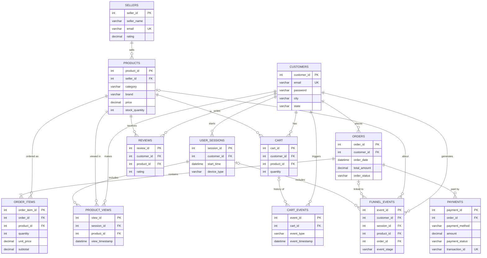

# Shopping Funnel — E-commerce DBMS Project

An online clothing and footwear store (Django + MySQL 8) that records every step a shopper
takes — **view → cart → checkout → order → payment → review** — and analyses where
customers drop off. Most of the logic lives **in the database**: constraints, triggers,
views and stored procedures.

## Features

| Area | What it does |
|---|---|
| Customers | Register / log in, browse 2,906 products, cart, checkout, simulated payment, order history, reviews |
| Sellers | Log in, add / edit / delete their own products |
| Admin | Manage customers, sellers, products, orders; **Funnel Analytics** page with charts |
| Funnel tracking | Every stage is written to `funnel_events` (by Django or by MySQL triggers) |
| Analytics | Conversion %, drop-off, cart abandonment, device / category / brand / seller breakdowns, daily trend, date-range funnel |

## Tech stack

- Python 3.11+ · Django 5.2 / 6.x · PyMySQL
- MySQL 8.0 (developed on 8.0.46)
- Chart.js 4.4.1 (bundled in `store/static`, works offline)

## Project structure

```
config/                 Django settings + URLs (DB login read from config/local_settings.py)
store/
  models.py             Django models for the existing MySQL tables (managed = False)
  views.py              Customer, seller and admin pages + analytics page
  templates/store/      HTML templates
  static/store/js/      chart.umd.min.js
  management/commands/
    create_sample_data.py     test customer / seller / admin accounts
    hash_plain_passwords.py   hash any plain-text passwords left in the tables
    generate_funnel_data.py   realistic demo shoppers (--delete removes them)
sql/                    All database scripts, run in numeric order (see below)
datasets/               products.csv, sellers.csv, product images, data dictionary
```

## Setup

### 1. Install

```bash
pip install -r requirements.txt
```

### 2. Database login for Django

Create `config/local_settings.py` (it is in `.gitignore`, so everyone keeps their own):

```python
DB_USER = "root"
DB_PASSWORD = "your-mysql-password"
```

(Or run `sql/00_create_app_user.sql` and use `DB_USER = "shop_app"`, `DB_PASSWORD = "ShopApp@2026"`.)

### 3. Build the database from scratch

In MySQL Workbench open and run each script (⚡ Execute All), **in this order**:

| # | Script | Creates |
|---|---|---|
| 1 | `sql/base_schema.sql` | database + 12 core tables (**drops existing ones**) |
| 2 | `sql/base_catalog.sql` | 16 sellers, 2,906 products |
| 3 | `sql/01_funnel_events.sql` | `funnel_events` table + indexes |
| 4 | `sql/02_triggers.sql` | 4 triggers |
| 5 | `sql/03_views_procedures.sql` | 7 views, 3 stored procedures |
| 6 | `sql/04_constraints_cleanup.sql` | CHECK / UNIQUE constraints, cart-history FK |
| 7 | `sql/05_device_view.sql` | device funnel view |
| 8 | `sql/06_cumulative_funnel.sql` | cumulative funnel rule for all funnel views + procedure |

Or from a terminal:

```bash
cd sql
for f in base_schema base_catalog 01_funnel_events 02_triggers 03_views_procedures 04_constraints_cleanup 05_device_view 06_cumulative_funnel; do
  mysql -u root -p shopping_funnel < $f.sql
done
```

> An **existing** database only needs scripts 01–06 (they are safe to re-run).

Then let Django create its own tables and the test accounts:

```bash
python manage.py migrate
python manage.py create_sample_data
python manage.py hash_plain_passwords
python manage.py generate_funnel_data        # optional: 300 demo shoppers
```

### 4. Run

```bash
python manage.py runserver
```

| Who | URL | Login |
|---|---|---|
| Customer | http://127.0.0.1:8000/login/ | `customer@example.com` / `pass123` |
| Seller | http://127.0.0.1:8000/seller/login/ | `seller@example.com` / `pass123` |
| Admin | http://127.0.0.1:8000/adminpanel/login/ | `admin` / `adminpass` |
| Analytics | http://127.0.0.1:8000/adminpanel/analytics/ | (as admin) |
| Demo shoppers | — | `<name>@demo.shop` / `demo1234` |

Remove demo data (restores stock): `python manage.py generate_funnel_data --delete`

---

## Database design

### ER diagram



`admin` is a standalone table (no relationships). Django adds its own `auth_*` / `django_*` tables.

### Normalization (3NF)

- **1NF** — every column holds one atomic value; no repeating groups. An order with several
  products is split into one `orders` row + many `order_items` rows instead of a list column.
- **2NF** — every table has a single-column surrogate primary key, so no non-key column can
  depend on only part of a key. (`order_items` would otherwise have the composite key
  *order + product*; `quantity` and `unit_price` depend on both, which is still 2NF.)
- **3NF** — no non-key column depends on another non-key column. Seller details live in
  `sellers`, not repeated in every product; customer details live in `customers`, not in
  every order. `order_items.unit_price` is deliberately a copy of the product price **at the
  time of purchase** (prices change later), so it is historical data, not a transitive dependency.
- **Controlled redundancy** — `orders.total_amount` and `order_items.subtotal` are derived
  values kept for fast reporting; the CHECK `subtotal = quantity * unit_price` and the clean-up
  script keep them consistent. `funnel_events` duplicates information from other tables on
  purpose: it is an append-only event log optimised for analytics queries.

### Integrity rules

| Kind | Examples |
|---|---|
| Primary / foreign keys | all 13 tables; `funnel_events` FKs use `ON DELETE SET NULL` for optional links |
| UNIQUE | customer / seller / admin email, one cart row per customer + product, payment transaction id |
| CHECK | rating 1–5, quantity > 0, price ≥ 0, stock ≥ 0, `subtotal = quantity × unit_price`, valid order / payment / cart-event / funnel stage values, email format, gender values |

### Triggers

| Trigger | Fires | Does |
|---|---|---|
| `trg_order_items_before_insert` | before an order line is inserted | locks the product row (`FOR UPDATE`) and raises an error (`SIGNAL 45000`) if stock is too low — the Django checkout runs in one transaction, so the whole order rolls back |
| `trg_order_items_after_insert` | after an order line is inserted | reduces `products.stock_quantity` |
| `trg_payments_after_insert` | after a successful payment | writes PAYMENT funnel events for every product in the order |
| `trg_reviews_after_insert` | after a review | writes a REVIEW funnel event |

### Views

All funnel views are **cumulative**: a customer who reached a later stage is also counted in every
earlier one (VIEW ≥ CART ≥ CHECKOUT ≥ ORDER ≥ PAYMENT), so old orders placed before view/cart tracking
existed still produce a sensible funnel. REVIEW is counted on its own.

| View | Answers |
|---|---|
| `vw_funnel_summary` | How many customers reached each stage? % from previous stage and from VIEW |
| `vw_product_funnel` | Funnel per product, view → paid % |
| `vw_category_funnel` | Funnel per gender / category / sub-category |
| `vw_brand_funnel` | Funnel per brand |
| `vw_cart_abandonment` | Who added what to the cart and never paid |
| `vw_seller_sales` | Units sold and revenue per seller (paid orders only) |
| `vw_daily_funnel` | Customers per stage per day |
| `vw_device_funnel` | Sessions, cart → order % per device |

### Stored procedures

```sql
CALL sp_funnel_between('2026-09-01', '2026-09-30');  -- funnel for a date range
CALL sp_customer_journey(10);                         -- one customer's path in time order
CALL sp_top_products(10);                             -- best sellers by revenue
```

### Transactions

Checkout (`views.checkout`) wraps order + order items + funnel events + cart clearing in a
single `transaction.atomic()` block. If the stock trigger rejects any item, everything is
rolled back and the customer sees *"Not enough stock for …"*.

### Sample analysis queries

```sql
-- Where do we lose the most customers?
SELECT stage, customers, pct_from_previous FROM vw_funnel_summary ORDER BY pct_from_previous;

-- Which categories convert best from cart to payment?
SELECT * FROM vw_category_funnel WHERE carted >= 10 ORDER BY cart_to_paid_pct DESC;

-- Mobile vs desktop
SELECT device_type, cart_to_order_pct FROM vw_device_funnel;

-- Revenue lost in abandoned carts
SELECT COUNT(*) AS carts, SUM(price) AS value FROM vw_cart_abandonment;
```
